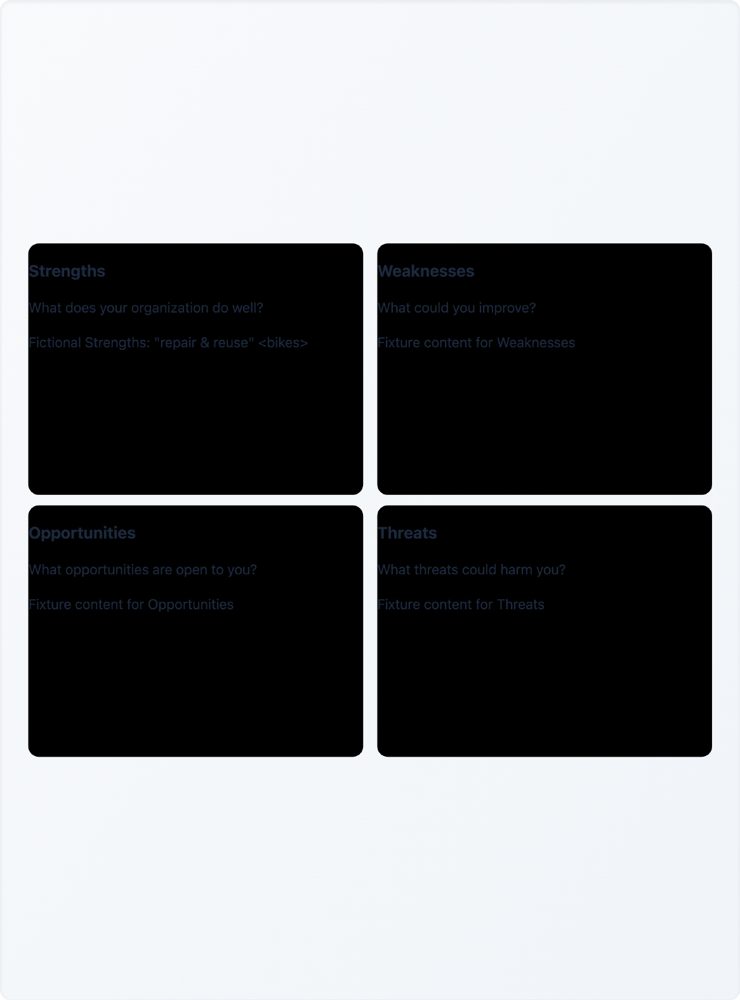
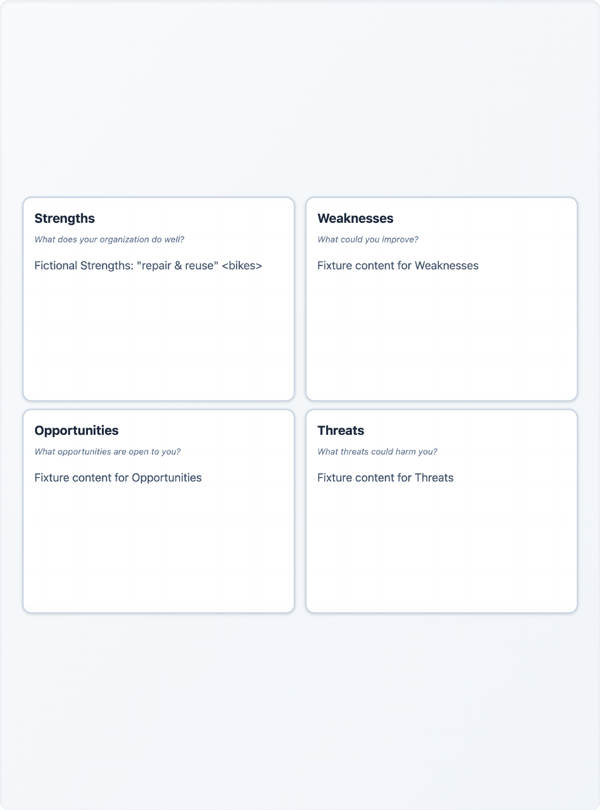

# Downloaded diagram paint verification

Base: `61a2067cce2d658094be73caaea2e05c67c4f63a`. The tested implementation and
test SHA-256 values, completed artifact hashes and measured colors are recorded
in [results.json](export-paint/results.json). These are local checks on macOS
arm64, Node 24.3.0, Bun 1.4.4, Playwright 1.62.1 Chromium and Poppler 26.03.0.

## Reproduced behavior and fix

The app shows white blocks in light mode and slate blocks in dark mode. On the
base, downloading any format instead paints those blocks black, drops their
borders and loses text layout. The SVG remains valid XML and retains the edit:
content preservation alone does not establish a readable diagram.

`html-to-image` 1.11.13 deep-clones SVG roots and skips descending into them
(`cloneSingleNode` / `cloneChildren` in its `clone-node.ts`). It therefore does
not inline the CSS of shapes or the HTML inside `foreignObject`. Their class
names survive, but the application's stylesheet does not accompany the file.

The shared capture path now makes a temporary, correctly sized clone and
materializes computed styles throughout its SVG subtrees, including embedded
HTML. Same-document paint/marker references stay local fragments. Capturing
that clone preserves the existing SVG, PNG, JPEG and PDF encoders. The live
canvas is untouched and the offscreen host is removed in `finally`.

## Matched workflow

The same final `export-paint.spec.ts` ran with the original ExportModal from
the base, then with the fix restored. Both used the real local test server's
fictional `fake` provider. No network response or export function was mocked.
The brief describes a fictional bicycle repair cooperative. Each test generates
a canvas, keyboard-edits a block with quoted text, `&` and literal `<bikes>`,
then saves and inspects all four completed downloads.

For Business Model, Porter, Value Proposition and SWOT light, plus SWOT dark:

- Parse downloaded SVG bytes with DOMParser; require no XML errors, the
  correct block count and the exact edited text.
- Open the saved SVG in a separate page with HTTP(S) requests blocked. Compare
  its native computed fill, stroke, heading font size and text color with the
  live canvas; require no failed external requests.
- Decode the actual PNG and JPEG bytes in Chromium and sample an interior
  block pixel. Render the actual PDF with `pdftoppm` and sample that PNG.
- Require the live descendant style attributes to remain unchanged and no
  snapshot host to remain after exporting. Settle block hover transitions
  between captures so each format is compared in the same visual state.

| Check | Original renderer | Fixed renderer |
| --- | --- | --- |
| Five valid SVGs, block counts, exact quoted edits | Pass | Pass |
| Standalone SVG paint / heading styles | All five fail: black fill, no border | All five match live |
| PNG interior RGB, light / dark | `(0,0,0)` / `(0,0,0)` | `(255,255,255)` / `(29,41,61)` |
| JPEG interior RGB, light / dark | `(0,0,0..2)` / `(0,0,2)` | within 1 channel value of live |
| Rendered PDF interior RGB, light / dark | `(0,0,0)` / `(0,0,0)` | `(254,254,254)` / `(28,40,60)` |
| New browser workflows | 5 failed, all 20 files still inspected | 5 passed |
| Full browser suite | Not rerun on base | 9 passed, 34.3 s |

Pixel tolerances are 3 for PNG, 15 for lossy JPEG and 5 for Poppler's PDF
rendering, per RGB channel. Soft paint assertions collect all formats on the
failing base; XML/content controls remain hard assertions. Missing Poppler is
explicitly annotated as an unrun PDF pixel check; it was installed and all five
PDFs were rendered in this verification.

These are unedited renders of the actual light SWOT PDFs, visually inspected
alongside the actual PNG downloads and dark PDF render:

| Before | After |
| --- | --- |
|  |  |

## Executed checks and reproduction

`bun run check:secrets`, `bun run type-check`, `bun run lint`, `bun run test`
(16 tests), `bun run build:client`, `bun run build:server` and the full browser
suite passed. One intermediate type check raced Vite removing generated JS;
it was rerun successfully after the build finished. No dependency changes.

The existing Playwright server command uses npm internally. For this Bun-only
run, an external config imported `playwright.config.ts`, preserved its browser
settings and replaced only the server command with
`bun run build:client && bun run build:server && bun run start:test`, with the
repository as `cwd`, HOST=127.0.0.1, PORT=3001 and reuseExistingServer=false.
Run `bun run test:e2e -- --config=<that-config> --reporter=line
--output=<artifact-directory>`; add `export-paint.spec.ts` for the five focused
cases. No packages were installed for this change.

`bun audit --audit-level=high` exited 1: four existing advisories (one critical,
three high) across DOMPurify, Vite and Zod. The package lock remains identical
to the base; this change does not resolve or assess those advisories.

## Limits

Live provider calls, hosted CI, Firefox, WebKit and non-browser SVG editors
were NOT RUN. Fictional fixtures prove the export workflow, not model strategy
quality. PDFs remain raster images, as before. Full computed styles increase
SVG size: approximately 30–36 KB before versus 522–1,095 KB in these cases.
The checks establish sampled paint and selected text styling, not universal
pixel identity or preservation of every possible scrolled content state.
Existing template geometry, including BMC overlap and Porter arrows covered by
PRs #7 and #8 respectively, is outside this change. This does not close issue
#1 or replace PR #3's separate XML/attribute acceptance work.
